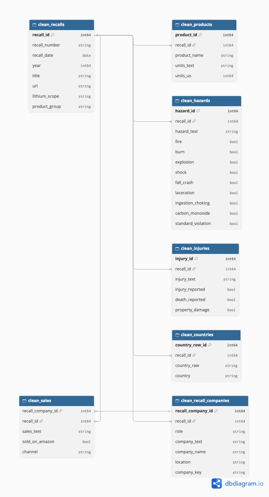
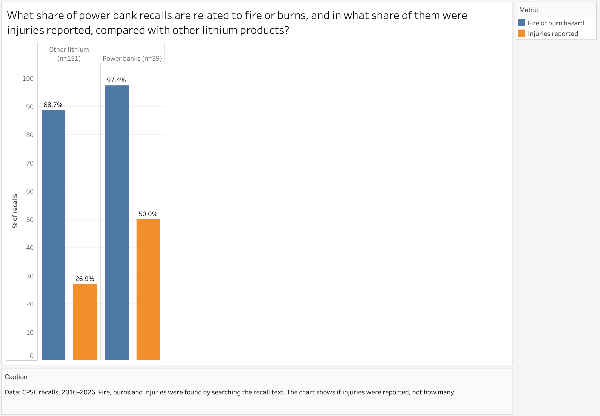
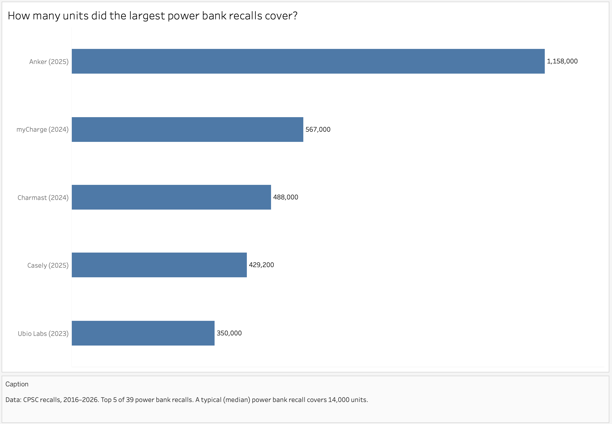
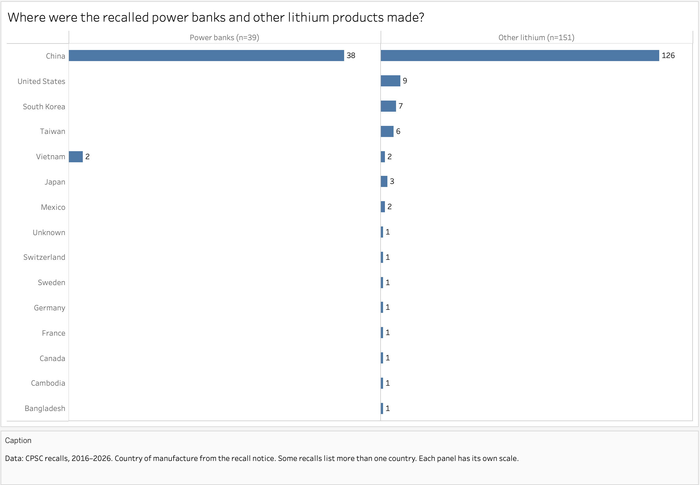
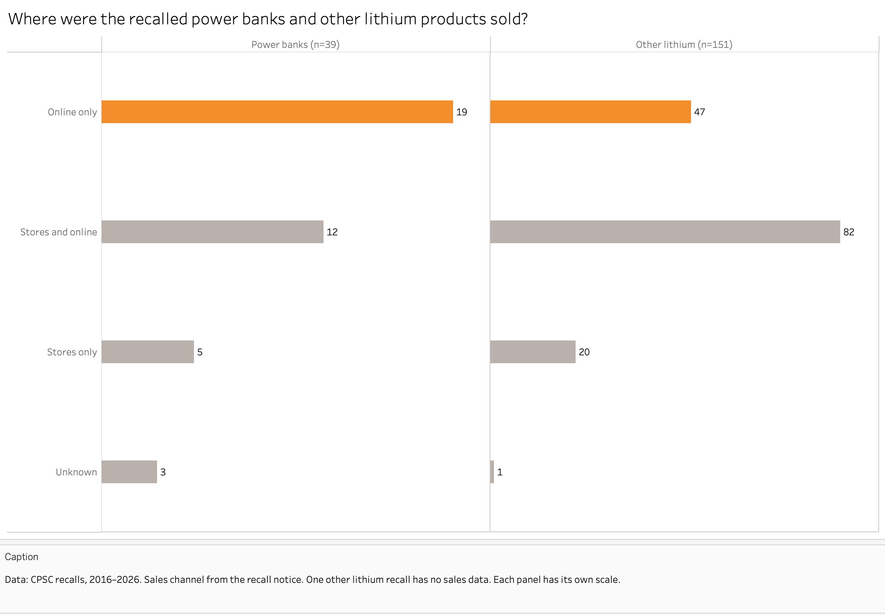
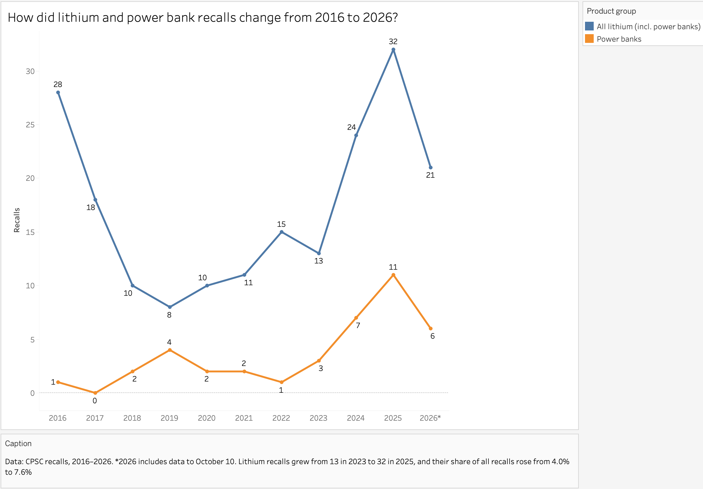

# Power Bank Launch Risk: CPSC Recall Analysis
## Table of Contents
 
- [Project Background](#project-background)
- [Executive Summary](#executive-summary)
- [Data Structure Overview](#data-structure-overview)
- [Insights Deep Dive](#insights-deep-dive)
  - [Q1. Share of power banks](#q1-share-of-power-banks)
  - [Q2. Fire, burns and injuries](#q2-fire-burns-and-injuries)
  - [Q3. Size of recalls](#q3-size-of-recalls)
  - [Q4. Countries, sales channels and repeat companies](#q4-countries-sales-channels-and-repeat-companies)
  - [Q5. Recalls by year](#q5-recalls-by-year)
- [Recommendations](#recommendations)
- [Assumptions and Caveats](#assumptions-and-caveats)
- [Technical Details](#technical-details)
---
 
## Project Background
 
A US online electronics store got an offer from a new supplier: to sell its power banks on the store's platform. The Head of Product Safety & Compliance has to make a decision and asked for a risk analysis of this product: what share of recalls are power banks, how often recalls are linked to fire or burns and injuries, how large recalls can be (how many units one recall affects), and which supplier features (country of manufacture, sales channel, repeat recalls of the same company) are common among recalls. This question is especially relevant now: in 2025, there were 2.5 times more recalls of products with lithium batteries in the US than in 2023 (32 vs 13). Based on the analysis, one of three options must be chosen: work with the new supplier, refuse, or agree under certain conditions.

## Executive Summary
 
Analysis of CPSC product recalls from 2016 to October 10, 2026: 3,405 recalls, 190 of them for products with a lithium battery and 39 for power banks. Among lithium products, power banks are about one in five recalls (20.5%). Almost all power bank recalls are linked to fire or burns (97.4%), and half of them reported injuries. This is almost 2 times more often than for other lithium products (50.0% vs 26.9%). The median recall affects 14,000 units (half of recalls are smaller, half are bigger), but the largest one (Anker, 2025) affected 1,158,000. Almost half of recalled power banks were sold only online (48.7%), and from 2023 to 2025, lithium product recalls grew 2.5 times.
 
**Recommendation:** agree to work with the supplier under conditions: check the supplier's history in the CPSC database, ask for battery tests, start with a small batch and a recall plan, and keep track of new recalls.
 
## Data Structure Overview
 
The data comes from the CPSC Recalls API (saferproducts.gov), downloaded on October 10, 2026. The analysis uses 7 tables, all linked by `recall_id`. `clean_sales` is also linked to `clean_recall_companies` by `recall_company_id`.
 
- `clean_recalls` — 10,047 recalls from 1973–2026; 3,405 recalls from 2016–2026 are used in the analysis. Columns: recall_id, recall_number, recall_date, year, title, url, lithium_scope, product_group.
  In product_group, each recall is marked as non_lithium, other_lithium or power_bank. Lithium products were found by keywords (lithium, Li-ion, power bank and others) and checked by hand: out of 235 candidates, 190 were kept, 39 of them are power banks.
- `clean_products` — 11,947 rows. Columns: product_id, recall_id, product_name, units_text, units_us.
- `clean_hazards` — 9,924 rows. Columns: hazard_id, recall_id, hazard_text and 9 TRUE/FALSE labels found by keywords: fire, burn, explosion, shock, fall_crash, laceration, ingestion_choking, carbon_monoxide, standard_violation.
- `clean_injuries` — 8,377 rows. Columns: injury_id, recall_id, injury_text, injury_reported, death_reported, property_damage.
- `clean_countries` — 8,890 rows. Columns: country_row_id, recall_id, country_raw, country.
- `clean_recall_companies` — 14,572 rows. Columns: recall_company_id, recall_id, role, company_text, company_name, location, company_key.
- `clean_sales` — 8,327 rows. Columns: recall_company_id, recall_id, sales_text, sold_on_amazon, channel.

 
## Insights Deep Dive
 
### Q1. Share of power banks
 
*What share of lithium battery product recalls and of all CPSC recalls in 2016–2026 are power banks?*
 
From 2016 to 2026, CPSC published 3,405 recalls. 190 of them are about products with a lithium battery (5.6%), and 39 of these 190 are power banks. So power banks make up 20.5% of lithium product recalls and only 1.1% of all recalls. Among all recalls this is not much, but among lithium products power banks are about one in five recalls (39 out of 190, 190 / 39 ≈ 4.9).
 
### Q2. Fire, burns and injuries
 
*What share of power bank recalls are linked to fire or burns, and in how many of them were injuries reported? How does this compare with other lithium products?*
 
Two groups were compared: power banks and other lithium products. Out of 39 power bank recalls, 38 are linked to fire or burns, which is 97.4%. In 19 of these 38, injuries were reported, so in 50.0% of cases. For other lithium products, 134 out of 151 recalls are linked to fire or burns (88.7%), and injuries were reported in 36 of them (26.9%).
 
Fire or burns is the main hazard for both groups, but for power banks these recalls end with injuries almost 2 times more often (50.0 / 26.9 ≈ 1.9). At the same time, there are only 39 power bank recalls, and one recall changes the share by about 2.6 points (1 / 39), so the difference between 97.4% and 88.7% should be seen as approximate.
 
This shows what hazard the recalls are linked to, not how often power banks catch fire: we have no sales data.
 

 
### Q3. Size of recalls
 
*How many units does a power bank recall usually affect, and are there very large recalls?*
 
The same two groups were compared. A typical power bank recall affects 14,000 units (median of 39 recalls), and for other lithium products it is 11,500 units (median of 151 recalls). The median was used instead of the average, because a few very large recalls would push the average up, and a typical recall would look bigger than it is.
 
But very large recalls also happen. The largest power bank recall is Anker in 2025 with 1,158,000 units, which is about 83 times the median (1,158,000 / 14,000 ≈ 83). Even the fifth largest recall (Ubio Labs, 350,000 units) is 25 times the median. For other lithium products, the largest recall is 2,500,000 units, so such cases happen in both groups. All five largest power bank recalls were in 2023–2025.
 
For the store, this means that a recall is usually small, but one bad product can affect more than a million units.
 

 
### Q4. Countries, sales channels and repeat companies
 
*Which countries do recalled power banks come from, where were they sold (only online or in regular stores), and do the same companies appear in recalls more than once?*
 
Recalled power banks came from China (38 recalls) and Vietnam (2 recalls). Together this is 40, not 39, because one recall lists both countries. So China appears in 97.4% of power bank recalls (38/39).
 
Other lithium products come from more countries, but China is also first: 126 out of 151 recalls (83.4%). Next are the US (9), South Korea (7), Taiwan (6) and Japan (3).
 
The data has only recalled products, so we can't say that products from China are more dangerous. To check this, we would need data on all sold power banks, not only recalled ones.
 

 
19 out of 39 power banks (48.7%) and 47 out of 151 other lithium products (31.1%) were sold only online. Both in stores and online: 12 out of 39 power banks (30.8%) and 82 out of 151 other lithium products (54.3%). The groups have different sizes, so we look at percentages. Power banks were sold only online more often than other lithium products, and our store also sells online.
 

 
6 companies appear in power bank recalls more than once: Belkin 3 times, Anker, myCharge, Baseus, Waymeet and Spector & Co. 2 times each. Some of them are well-known brands, so even a well-known brand can have a recall.
 
### Q5. Recalls by year
 
*How did the number of lithium product and power bank recalls change by year?*
 
In 2016, there were 28 lithium product recalls, and only one of them was a power bank.
 
In 2019, there were the fewest lithium product recalls in 2016–2026, only 8. But there were 4 power bank recalls that year, the highest number in 2016–2023.
 
The most recalls were in 2025: 32 for lithium products and 11 for power banks. From 2023 to 2025, lithium product recalls grew from 13 to 32 (2.5 times, 32 / 13 ≈ 2.5), and power bank recalls grew from 3 to 11. All CPSC recalls grew only 1.3 times in this period (420 / 324 ≈ 1.3), so the share of lithium products among all recalls also grew: from 4.0% to 7.6%.
 
By October 10, 2026, there were 21 lithium product recalls and 6 power bank recalls, but the year is not over yet, so it can't be compared with other years.
 

 
## Recommendations
 
**Decision:** agree to work with the new supplier, but under conditions.
 
Before signing the contract
 
- **Check the supplier's history:** look for the supplier in the CPSC recall database. If it already had recalls, refuse or ask for extra checks. 6 companies appear in power bank recalls more than once, and some of them are well-known brands.
- **Ask for battery tests:** an independent check for overheating and fire before sales start. 97.4% of power bank recalls are linked to fire or burns, and half of them reported injuries.
Before launch
 
- **Start with a small batch and prepare a recall plan:** decide in advance how to quickly remove the product from the website and contact customers. A typical recall affects 14,000 units, but the largest ones affect more than a million.
After launch
 
- **Keep track of new recalls:** regularly check the CPSC database for power banks and for this supplier. Lithium product recalls grew 2.5 times from 2023 to 2025, so the risk may grow over time.
- 
## Assumptions and Caveats
 
- The analysis covers only 2016–2026, because lithium products were searched only in recalls from these years. 2026 is not over yet, the data was collected up to October 10.
- In CPSC data, the product type and hazard type are often empty. So lithium products, power banks and hazards (fire, burns, etc.) were found by keywords in the recall text. Lithium products were also checked by hand: out of 235 candidates, 190 were kept, and 39 of them are power banks.
- Portable power stations were not counted as power banks and were included in other lithium products. Coin batteries were excluded completely, because their main risk is different: children swallow them, and this is not related to fire.
- The number of units was taken only for the US, so sales in other countries (for example, Canada) are not counted. In recalls with several products, some products have no number of units, so the total for such a recall may be lower than the real one.
- For injuries, only a yes/no mark was used. The exact number of cases is written in the recall text in different forms, and for the analysis questions it was enough to know if there were injuries.
- One recall can list more than one country. So for power banks the total by country is 40, not 39: one recall lists both China and Vietnam. Also, one lithium recall has no sales channel data.
- Companies were compared by name without punctuation. For power bank recalls, the list of companies was checked by hand, and two companies written in different ways were merged (Belkin and Spector & Co.).
- The data has only recalled products and no sales data. So 97.4% shows what hazard power bank recalls are linked to, not how often power banks catch fire. And the fact that almost all recalled power banks are from China does not mean that products from China are more dangerous.
- There are only 39 power bank recalls, and one recall changes the share by about 2.6 points (1 / 39). So small differences in percentages should be seen as approximate.
## Technical Details
 
- SQL queries: [sql/](sql/) folder, load checks, table cleaning and analysis queries, with comments.
- Visualizations: [images/](images/) folder, Tableau Public charts exported as PNG and the ERD from dbdiagram.io.
- Data collection scripts: [scripts/](scripts/) folder (`check_categories.py` downloads recalls from the CPSC Recalls API, `build_scope.py` finds lithium products by keywords, `split_tables.py` splits the data into tables).
- Source data: [data/](data/) folder (`lithium_candidates.csv` with the manual check of lithium products). Raw data (`recalls_all.json`) is not uploaded because of its size, run `check_categories.py` to download it.
